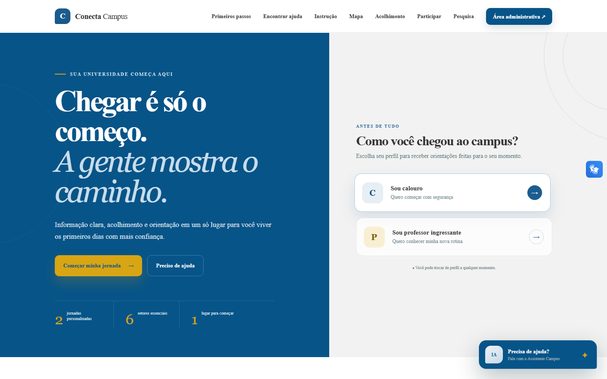
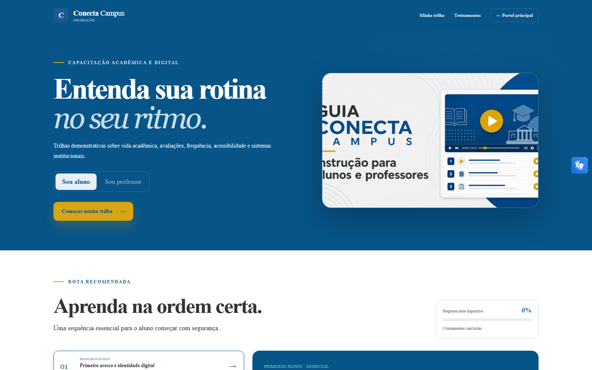
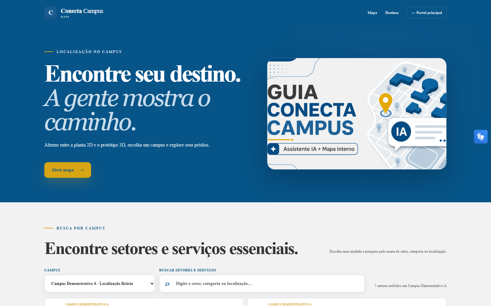
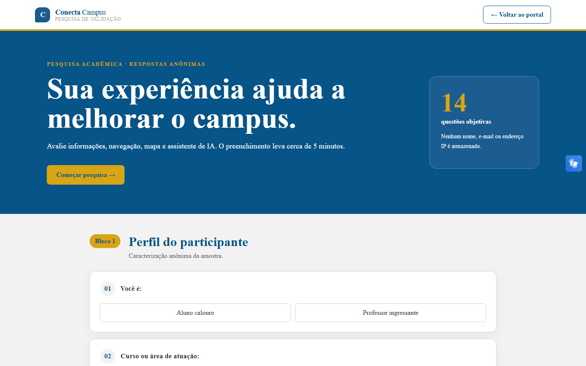
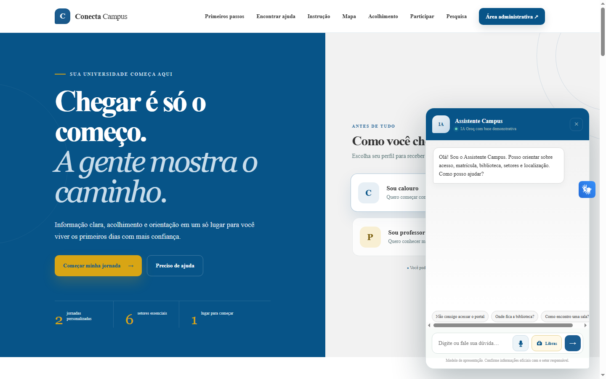
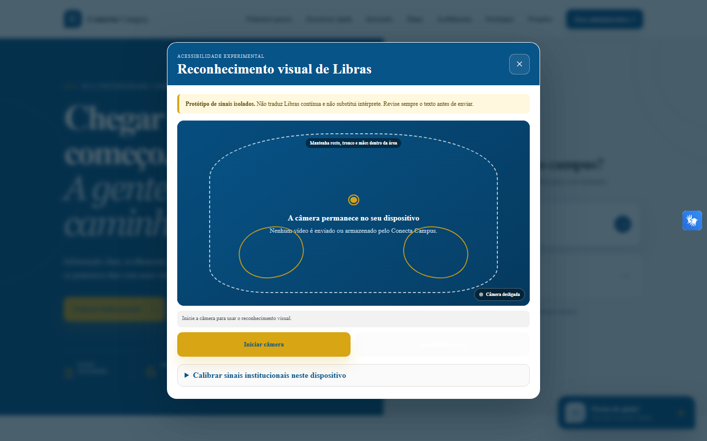

# 🧭 Conecta Campus

**Plataforma de acolhimento, orientação e escuta para a comunidade acadêmica.**

🏆 **1º lugar no Inova CEUMA 2026.**

O Conecta Campus reúne, em uma experiência web e Android, orientações para quem está chegando, trilhas de instrução, mapa interno demonstrativo, assistente de dúvidas, participação comunitária e indicadores administrativos.

> Este é um repositório de **showcase**. O código-fonte principal permanece separado em [`JuniorDdev/conecta-campus`](https://github.com/JuniorDdev/conecta-campus).

## O problema

Calouros, professores ingressantes e visitantes precisam localizar informações sobre rotinas, serviços e espaços do campus. Quando essas orientações estão fragmentadas, dúvidas simples se transformam em deslocamentos desnecessários, insegurança e dificuldade de adaptação. Ao mesmo tempo, sugestões e avaliações da comunidade precisam chegar aos responsáveis de forma organizada.

## A solução

O Conecta Campus organiza a jornada de chegada em um único ponto de acesso:

```text
Pessoa chega ao portal
        ↓
Seleciona seu perfil e encontra orientações
        ↓
Consulta trilhas, mapa ou Assistente Campus
        ↓
Envia sugestão, avaliação ou pesquisa anônima
        ↓
Gestão acompanha dados agregados no painel administrativo
```

A base exibida no MVP é demonstrativa. Informações que dependem de uma instituição devem ser confirmadas antes de uma publicação oficial.

## Telas

| Portal de acolhimento | Trilhas de instrução |
|---|---|
|  |  |

| Mapa interno demonstrativo | Pesquisa anônima |
|---|---|
|  |  |

| Assistente Campus | Acessibilidade experimental em Libras |
|---|---|
|  |  |

| Experiência móvel usada pelo APK Android |
|---|
|  |

## Principais funcionalidades

- portal responsivo com orientações por perfil;
- jornadas e missões de acolhimento para calouros e professores ingressantes;
- busca e filtros de conteúdo;
- 17 módulos de instrução com progresso armazenado no navegador;
- mapa interno 2D com sete destinos e protótipo 3D para três campi demonstrativos;
- Assistente Campus com recuperação SQLite FTS5, fontes consultadas e integração opcional com a Groq;
- entrada do assistente por texto e voz em português;
- protótipo experimental de reconhecimento de sinais isolados, com processamento no navegador;
- widget VLibras nas rotas públicas;
- experiência pública responsiva disponível na web e reunida em um aplicativo Android Flutter/WebView;
- envio de sugestões e avaliações por setor;
- pesquisa anônima de validação com 14 questões;
- painel administrativo com autenticação, filtros, indicadores e exportações CSV, XLSX e PDF;
- aplicativo Android em Flutter que reúne as rotas públicas do sistema hospedado.

## Web + APK Android

O Conecta Campus opera em duas formas de acesso conectadas ao mesmo backend:

- **Web responsiva:** acesso pelo navegador em computador, tablet ou celular;
- **APK Android:** aplicativo Flutter que incorpora as rotas públicas hospedadas por meio de WebView, preserva a navegação interna e oferece acesso ao assistente, ditado por voz e reconhecimento visual experimental de Libras.

O APK não duplica o backend nem mantém uma base de dados independente. Ele depende da URL HTTPS configurada durante a compilação.

## Acessibilidade e Libras

- widget oficial **VLibras** nas rotas públicas para tradução do texto da página por avatar;
- captura de voz em português no Assistente Campus;
- módulo experimental de reconhecimento visual de **sinais isolados**, executado no navegador;
- calibração de cinco exemplos por frase armazenada somente no `localStorage` do dispositivo;
- vídeo da câmera não é enviado nem armazenado pelo Conecta Campus.

O reconhecimento visual não traduz Libras contínua, deve ser calibrado com apoio de alguém que conheça Libras e não substitui intérprete.

## Perfis de acesso

| Perfil | Experiência disponível |
|---|---|
| Calouro | Orientações, jornadas, instruções, mapa, assistente, participação e pesquisa |
| Professor ingressante | Jornada docente, instruções, mapa, assistente, participação e pesquisa |
| Visitante | Consulta às áreas públicas e orientações gerais |
| Administrador | Dashboard autenticado, filtros, acompanhamento de sugestões e exportações |

O portal público não exige identificação pessoal. A área administrativa exige autenticação própria.

## Stack tecnológica

| Camada | Tecnologias existentes no projeto |
|---|---|
| Backend | Python 3.13, Flask 3.1, Gunicorn |
| Persistência | SQLite e SQLite FTS5 |
| Assistente | Groq SDK com fallback documental local |
| Frontend web | HTML, CSS e JavaScript sem framework |
| Visualização e relatórios | Chart.js, openpyxl e ReportLab |
| Acessibilidade experimental | VLibras e MediaPipe Tasks Vision |
| Aplicativo Android | Flutter, Dart e WebView |
| Deploy | Railway com Railpack; suporte documentado para PythonAnywhere |

## Autoria

O Conecta Campus é um projeto acadêmico independente desenvolvido pela equipe do tema **“Manual do Calouro e do Professor Ingressante”**.

1. **Cecília Fernanda** — idealização do tema “Manual do Calouro e do Professor Ingressante”;
2. **Domingos Júnior e Geovane Paixão** — desenvolvimento do sistema Conecta Campus;
3. **Saulo José** — novas ideias para o sistema, desenvolvimento do slide e revisão.

O projeto Conecta Campus é uma realização coletiva da equipe, com as responsabilidades individuais descritas acima.

Os créditos não caracterizam o Conecta Campus como sistema oficial de qualquer instituição de ensino.

## Visualizar localmente

Como o showcase é estático, basta servir a pasta `docs`:

```bash
python -m http.server 8080 --directory docs
```

Depois, abra:

```text
http://127.0.0.1:8080
```

Também é possível abrir `docs/index.html` diretamente no navegador, mas o servidor local oferece uma validação mais fiel ao GitHub Pages.

## Privacidade das imagens

As capturas deste showcase foram produzidas em ambiente demonstrativo e exibem somente conteúdo fictício ou institucionalmente neutro. **Nenhum dado real de usuário, estudante, professor ou instituição é exposto.**

## Estrutura

```text
conecta-campus-showcase/
├── README.md
└── docs/
    ├── index.html
    └── assets/
        ├── style.css
        ├── landing.js
        └── screenshots/
            ├── portal.png
            ├── instrucoes.png
            ├── mapa.png
            ├── pesquisa.png
            ├── assistente.png
            ├── acessibilidade-libras.png
            └── android.png
```
